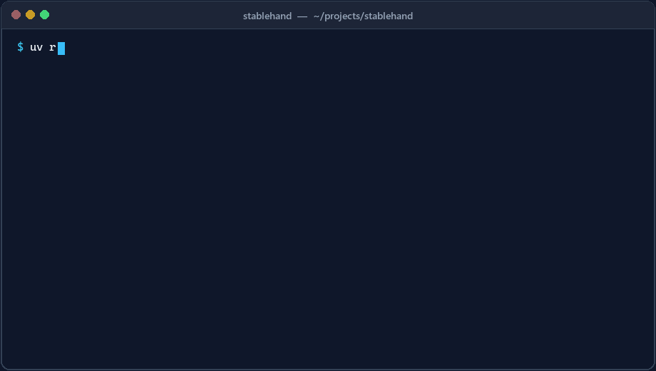

# stablehand

[](https://github.com/Dudziak07/stablehand/actions/workflows/ci.yml)
[](LICENSE)
[](https://github.com/Dudziak07/stablehand/releases)

**A stable for building agents.** stablehand is not a pack of ready-made coding agents. It is the tack room you visit to build the *right* skills, subagents and instructions for **your** repository, on the platform you use: Claude Code, Google Antigravity, OpenCode or OpenAI Codex CLI.

You open stablehand, name your repository and what you need, and stablehand:

- **designs** the setup: what belongs in always-loaded instructions, which skills, which subagents (only when they earn their keep) and which hooks;
- **writes** each artifact test-first: it watches the agent fail without the artifact, writes the minimum that fixes it, and re-tests;
- **evaluates** artifacts against a baseline run, so you know they help;
- **ports** artifacts between platforms without losing behavior or permissions;
- **validates** formats and cross-platform collisions with a bundled linter.

Everything it builds goes into **your** repository, never into stablehand.



## Contents

- [Quick start](#quick-start)
- [What a session looks like](#what-a-session-looks-like)
- [Platforms](#platforms)
- [What's inside](#whats-inside)
- [Principles](#principles)
- [Safety](#safety)
- [Installation options](#installation-options)
- [Tools](#tools)
- [FAQ](#faq)
- [Contributing](#contributing)

## Quick start

**Requirements:**
- [uv](https://docs.astral.sh/uv/) and git. uv fetches the Python version the tools need.
- At least one platform:
  - [Claude Code](https://code.claude.com) (CLI, desktop app or IDE extension);
  - [Google Antigravity](https://antigravity.google) (App, IDE or the `agy` CLI);
  - [OpenCode](https://opencode.ai) with any model provider. A DeepSeek setup is included in `platforms/opencode/opencode.example.json`;
  - [OpenAI Codex CLI](https://developers.openai.com/codex) (CLI or VS Code extension; works on ChatGPT Free or with BYOK providers).
- Linux, macOS and Windows are tested in CI. On Windows, installs use directory junctions, which need no admin rights.

**1. Clone stablehand next to your project and wire it into your tool, once:**

```bash
git clone https://github.com/Dudziak07/stablehand && cd stablehand
uv run tools/install.py claude-code --scope workspace    # or: antigravity, opencode, all
```

**2. Open the stablehand folder with access to your repository:**

| Platform | How |
|---|---|
| Claude Code | `claude --add-dir ../shop-api` (or `/add-dir ../shop-api` in a session), then accept the trust prompt |
| Antigravity | IDE or App: open the stablehand folder, then add `../shop-api` to the workspace (multi-root). CLI: `agy --add-dir ../shop-api` in the stablehand folder. Antigravity runs commands only inside workspace folders |
| OpenCode | run `opencode` in the stablehand folder; approve the `external_directory` prompt when it reaches `../shop-api` |

**3. Ask for what you need:**

> I need a skill for `../shop-api` that runs our database migrations safely.
>
> Create a read-only review agent for `../shop-api`, for OpenCode.
>
> Set up agents and skills for `../shop-api`. What does it need?

## What a session looks like

1. **Target.** stablehand settles which repository and which platform the work is for, and confirms it in one line: `Target: ../shop-api · Platform: Claude Code · Building: a migrations skill`.
2. **Design.** It reads the repository, asks only what it cannot infer, and checks whether you really need an agent or whether a skill fits better. It shows a plan and **writes nothing until you approve it**.
3. **Baseline.** It runs realistic scenarios *without* the artifact in a scratch copy of your repository and records how the agent fails.
4. **Write.** It writes the smallest artifact that fixes those failures, in your platform's native format and folder.
5. **Re-test and lint.** It runs the same scenarios *with* the artifact, checks that it triggers on the right prompts and not on near misses, and lints it.
6. **Independent review.** A separate read-only reviewer agent checks the artifact against its contract and the platform's rules.
7. **Hand-over.** You get the paths, how to invoke the artifact, the baseline-vs-with-artifact results, and anything still untested.

Evals and results are saved in your repository under `.stablehand/`. You can commit them as regression tests or ignore them.

**Building for another platform** (for example, from Claude Code "for OpenCode"): you get the artifact, linted for that platform, plus a ready-to-paste prompt that runs its tests there. A different harness and model would make local test runs meaningless.

## Platforms

| Platform | Status | Evaluation |
|---|---|---|
| [Claude Code](platforms/claude-code/) | ✅ reference implementation | eval suite in [`platforms/claude-code/evals`](platforms/claude-code/evals/) for `claude plugin eval` |
| [Google Antigravity](platforms/antigravity/) (App, IDE, `agy` CLI) | ✅ implemented | outcome gain in 4 of 4 conclusive scenarios, 3 runs per arm ([results](platforms/antigravity/evals/RESULTS.md)) |
| [OpenCode](platforms/opencode/) (with DeepSeek or any provider) | ✅ implemented | outcome gain in 4 of 5 behavior scenarios, 3 runs per arm ([results](platforms/opencode/evals/RESULTS.md)) |
| [OpenAI Codex CLI](platforms/codex/) (`codex`, VS Code extension) | ✅ implemented | smoke-tested on `codex-cli 0.172.0` ([port notes](platforms/codex/PORT-NOTES.md); full evals pending) |

On every platform the negative control passes: no stablehand skill fires on an unrelated request. Each platform implements the same [contracts](contracts/) (2026.11.1) and was ported and tested by that platform's own agent. More platforms can be added: see [docs/adding-a-platform.md](docs/adding-a-platform.md).

## What's inside

**Skills** (invoke them directly with `/stablehand:<skill>` in Claude Code and Antigravity, or `/<skill>` in OpenCode, or just describe what you need):

| Skill | What it does |
|---|---|
| `designing-agent-setups` | **Start here.** Inventories a repository, interviews you, proposes a justified blueprint (instructions, skills, agents, hooks) and builds it in order |
| `authoring-skills` | Creates or improves one skill, test-first, with trigger tests and baseline comparison |
| `authoring-agents` | Creates one subagent, only when it is justified, with least-privilege permissions and benchmarks |
| `writing-project-instructions` | Writes or trims `AGENTS.md`, `CLAUDE.md`, `GEMINI.md` and rules to non-inferable facts and verified commands |
| `porting-artifacts` | Moves a skill, agent or instruction file to another platform, keeping behavior and permissions |
| `upgrading-artifacts` | Audits and upgrades existing skills, agents, rules and instructions (treating missing manifests as `unknown (legacy)`), supporting `keep / patch / rewrite / retire` |
| `evaluating-artifacts` | Builds and runs trigger tests, behavior scenarios and agent benchmarks against a baseline |
| `validating-artifacts` | Static checks with the bundled linter, including cross-platform name collisions |

**Agents** that the skills delegate to:

| Agent | Role |
|---|---|
| `artifact-reviewer` | Independent, read-only review of one artifact against its contract and the platform card |
| `scenario-runner` | Runs one eval scenario in isolation and reports what happened verbatim |
| `platform-researcher` | Re-checks a platform format against official documentation when the bundled knowledge may be stale |

## Principles

- **Skills first.** A subagent must earn its place with at least one of five reasons: context isolation, independence, different permissions, a different model, or parallelism. "Developer", "tester" and "orchestrator" agents usually fail this test, and orchestration belongs in the main conversation. ([decision guide](shared/references/decision-guide.md))
- **Test before you trust.** An artifact is done when a run shows it changes behavior, not when it reads well. ([eval protocol](shared/references/eval-protocol.md))
- **Same behavior, native mechanics.** Each platform gets its own implementation of shared [contracts](contracts/), checked against shared [evals](evals/). No lowest-common-denominator generator.
- **Small always-loaded context.** Instructions hold only what the agent cannot infer.
- **Knowledge with a date.** Platform formats change fast. Each platform card says when it was last verified, and the linter warns when a card is older than 90 days.

## Safety

- **Nothing is written before you approve the plan.** Artifacts go only into the target repository, never into stablehand.
- **Tests run in scratch copies** or git worktrees of your repository, never in your checkout. stablehand never commits in your repository.
- **Reviewers and researchers are read-only.** When a reviewer needs a command such as `git diff --staged`, it gets exactly that command through the platform's enforcement: a hook on Claude Code, an exact allow-list on OpenCode. Wildcards that would admit writing flags such as `--output=<file>` are rejected.
- **Platform quirks are tested, not assumed.** For example, OpenCode 1.19 enforced shell restrictions only under the `bash` permission key even though its docs named `shell`; re-tested on OpenCode 2.3.2, `shell` is now the enforced V2 action in `permissions` arrays, and the linter flags deprecated V1 `bash`/`task` action names as errors.
- **Baselines must be confined.** An unconfined agent will search your disk for examples, so a comparison that could reach the artifact is reported as inconclusive rather than counted.

## Installation options

| Scope | Command | Use it when |
|---|---|---|
| Workspace (recommended) | `uv run tools/install.py <platform> --scope workspace` | you open the stablehand folder and build for other repositories |
| Project | `uv run tools/install.py <platform> --scope project --project <repo>` | you want stablehand available inside one repository |
| User | `uv run tools/install.py <platform>` | you want it everywhere (`~/.config/opencode`, `~/.gemini/config/plugins`) |
| Claude marketplace | `claude plugin marketplace add Dudziak07/stablehand` then `claude plugin install stablehand@stablehand` | you prefer Claude Code's plugin system |

- Add `--dry-run` to see what an install would do, `--uninstall` to remove exactly what it created, and `--copy` to copy files instead of linking them. Links follow `git pull` automatically.
- An install never overwrites a folder it did not create unless you pass `--force`.
- On Windows with OpenCode, a project install links to the stablehand checkout outside that project, so OpenCode asks for `external_directory` access. Use `--copy` if that prompt stalls a headless run.

## Tools

Python tools run with [uv](https://docs.astral.sh/uv/). Dependencies are declared inline, so there is nothing to install first.

```bash
uv run tools/lint.py --platform claude-code path/to/skill-or-agent   # validate artifacts
uv run tools/lint.py --project path/to/your/repo                     # whole project, all platforms
uv run tools/lint.py --cards shared/references --strict              # are the platform cards recent?
uv run tools/sync.py                                                 # refresh generated copies
uv run --with pytest --with pyyaml pytest tools/tests -q             # tool tests
```

The linter is also bundled with the `validating-artifacts` skill, so the agents use it on your repository.

## FAQ

**Do I need all three platforms?** No. Install the one you use. The others are only needed if you want to build or test artifacts for them.

**Skill or agent: which do I need?** Usually a skill. Ask stablehand; it will tell you which of the five reasons an agent would serve, or why a skill is enough.

**Do evals cost money?** Yes: every run is a model call. stablehand tells you how many runs it plans before starting more than about ten, and you can skip testing on request; the hand-over then says "untested".

**Does it work with DeepSeek in Claude Code?** Yes. Agents use model tiers (`inherit`, `haiku`, `opus`) rather than pinned IDs, which compatible endpoints remap.

**What versioning does it use?** Calendar versioning, `YYYY.M.N`. See [contracts/README.md](contracts/README.md#versioning) and the [changelog](CHANGELOG.md).

## Repository layout

```
contracts/          what each stablehand skill/agent must do (platform-neutral)
evals/              shared scenarios + trigger sets that prove it
shared/references/  decision guide, writing guide, coexistence matrix, eval protocol, platform cards
platforms/<p>/      the implementation for platform p (Claude plugin, Antigravity plugin, OpenCode files)
tools/              lint.py · sync.py · install.py (+ tests)
docs/               architecture, adding a platform, sources
```

Details: [docs/architecture.md](docs/architecture.md).

## Contributing

See [CONTRIBUTING.md](CONTRIBUTING.md) and [AGENTS.md](AGENTS.md). In short:
1. Change behavior in `contracts/` first, then in every platform implementation.
2. Edit knowledge in `shared/references/`, never in its generated copies.
3. Run `uv run .agents/skills/auditing-stablehand/scripts/self_check.py --strict` before committing. CI runs the same checks on Linux, macOS and Windows.

Community participation is governed by the [Code of Conduct](CODE_OF_CONDUCT.md). Please report vulnerabilities privately using [SECURITY.md](SECURITY.md).

## License

[MIT](LICENSE). Credits for ideas and sources: [docs/sources.md](docs/sources.md).
